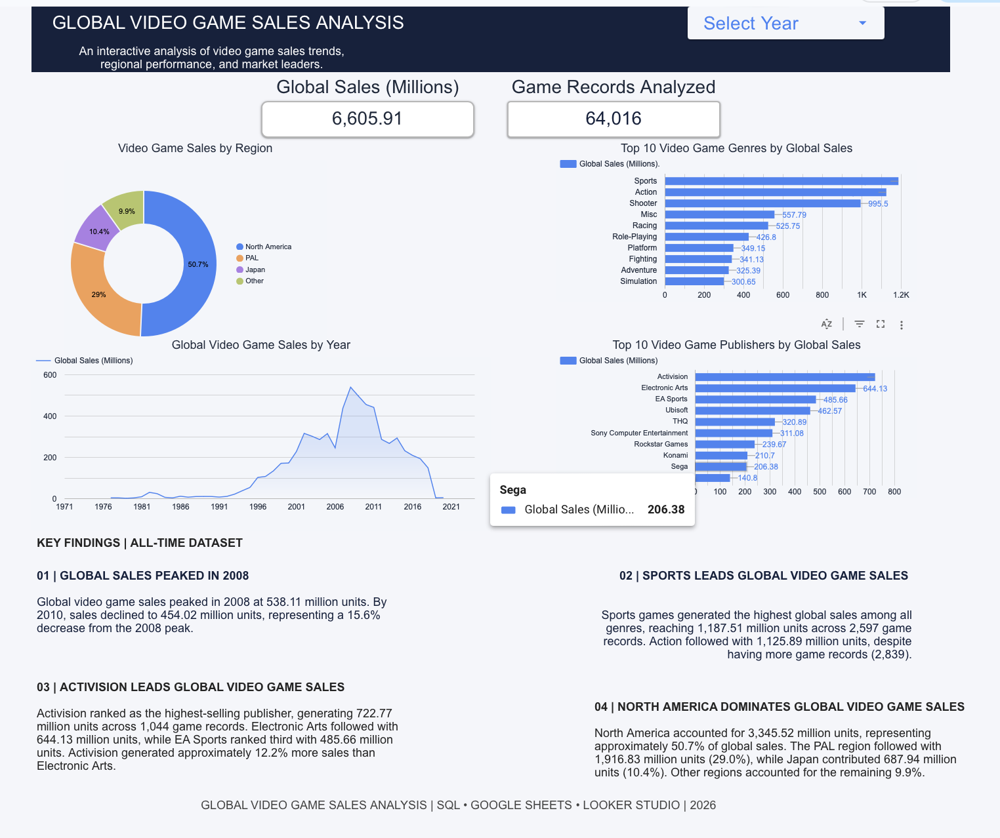

# 🎮 Global Video Game Sales Analysis

## 📊 Project Overview

An end-to-end data analytics portfolio project examining
64,016 video game records to identify global sales trends,
regional market performance, and industry leaders.

This project demonstrates SQL querying, data aggregation,
data visualization, and business intelligence reporting.

## 📊 Interactive Dashboard Preview

## 🛠️ Tools & Technologies

- SQL (DuckDB)
- DBeaver
- Google Sheets
- Google Looker Studio
- GitHub

## 🎯 Business Questions

1. How have global video game sales changed over time?
2. Which video game genres generate the most sales?
3. Which publishers dominate the global market?
4. Which geographic regions contribute the most sales?
5. What insights can be identified from historical sales data?

## 📈 Key Findings

### 1. Global Sales Peaked in 2008
- Global sales reached 538.11 million units in 2008.
- By 2010, sales declined to 454.02 million units.
- This represents a 15.6% decrease.

### 2. Sports Games Lead Global Sales
- Sports games generated 1,187.51 million units in sales.
- Action games followed with 1,125.89 million units.
- Sports achieved higher sales despite having fewer records.

### 3. Activision Leads Publishers
- Activision generated 722.77 million units in sales.
- Electronic Arts followed with 644.13 million units.
- EA Sports ranked third with 485.66 million units.

### 4. North America Dominates Regional Sales
- North America accounted for approximately 50.7% of sales.
- PAL regions contributed approximately 29.0%.
- Japan contributed approximately 10.4%.
- Other regions accounted for approximately 9.9%.

## 📊 Interactive Dashboard

Explore the interactive dashboard built using
Google Looker Studio.

**Dashboard Link:** [View Interactive Dashboard](https://datastudio.google.com/reporting/ab4b100e-2a31-4504-825a-5f4899f2b57a)

Dashboard features:
- Global sales KPI
- Total game records analyzed
- Regional sales distribution
- Top 10 genres
- Top 10 publishers
- Historical sales trends
- Interactive year filtering

## 💻 SQL Skills Demonstrated

- SELECT and WHERE
- GROUP BY and HAVING
- Aggregate functions (SUM, AVG, COUNT)
- CASE statements
- Common Table Expressions (CTEs)
- Window functions
- RANK and DENSE_RANK
- Data filtering and sorting

## 📁 Project Structure

The repository will contain:

- README.md — Project documentation
- SQL queries — Data exploration and analysis
- Dashboard screenshot — Visual project preview
- Dashboard link — Interactive analysis

## 📌 Project Summary

This project demonstrates the ability to transform
raw data into actionable insights using SQL and
business intelligence tools.

The analysis highlights historical sales trends,
market leaders, and regional performance across
the global video game industry.
